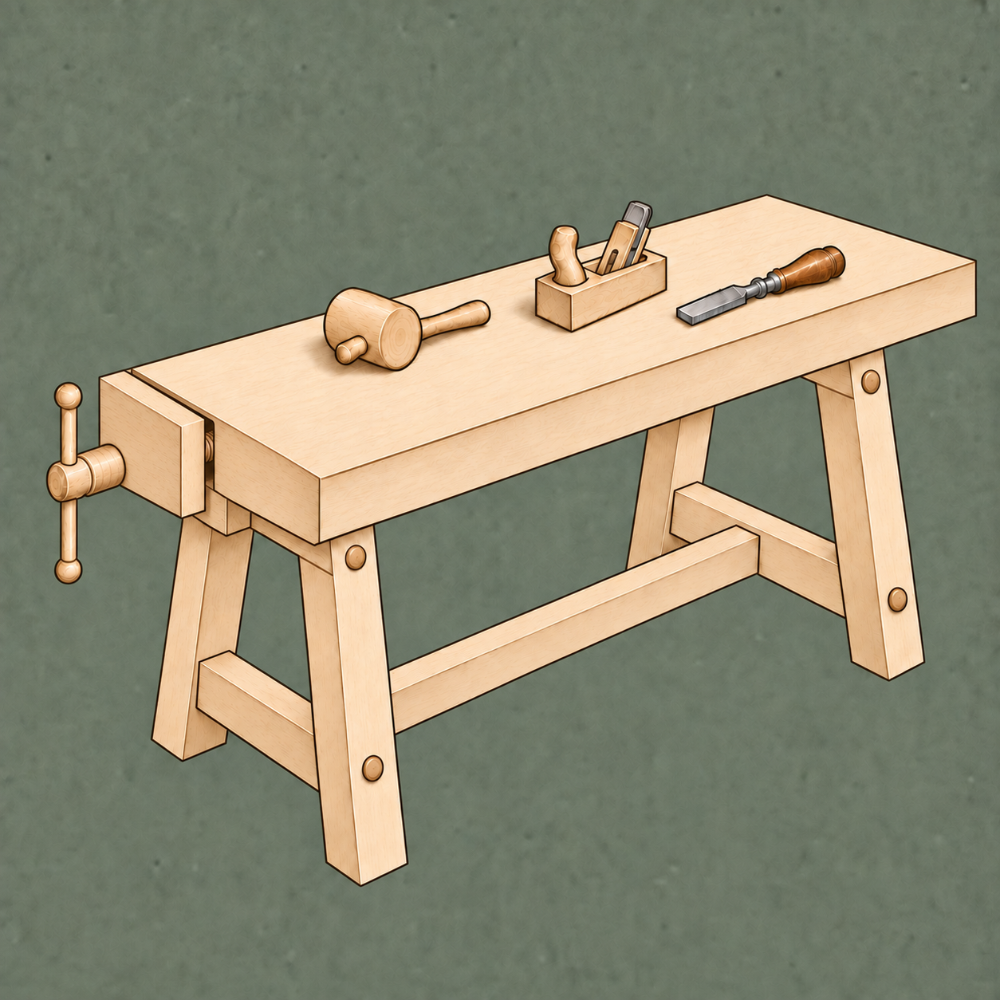

# What is gezel?

[Watch the Gezel playlist on YouTube](https://www.youtube.com/watch?v=KCdgV5YFDzI&list=PLaD2JMwhPJ3w) for a quick introduction and guided tours.

*Gezel* is Dutch for a companion journeyman: a skilled worker who has finished an apprenticeship and now works at your side. That is where the app gets its name. Gezel does its work through named helpers, each with a face, a role, a set of tools, and a story of their own that shapes how they think. Usually one of them carries a job from start to finish, and together they are your crew. They remember what you've done together and get better as you work with them.

## Someone to hand work to

Most AI tools hand you a blank text field. Gezel gives you someone to hand the work to. Say what you need, and usually one helper takes the job and sees it through, keeping notes along the way and picking up where they left off. Some jobs bring in more than one: a researcher to dig into a question, a reviewer to check the result. You can also add crew members yourself, each with the role you choose.

## Start with your Meester

Your first conversations are with the **Meester**: the guildmaster who acts as your concierge. Ask for what you need and they'll set up a project and bring in whoever the work calls for. You can also just chat with them :)

## Your data stays yours {[pullQuote]}

When you use local downloaded models, everything gezel does is powered by your device - no cloud account or expense required, and everything gezel creates lives on your own device.

## Where to go next

- Meet the Meester and the rest in [Your crew](the-crew.md).
- See how work is organized in [Projects and threads](projects-and-threads.md).
- Browse what each role can do in the Crew roles section of this Handboek.
